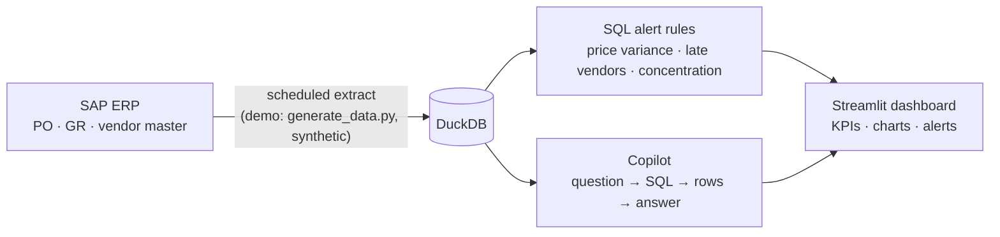
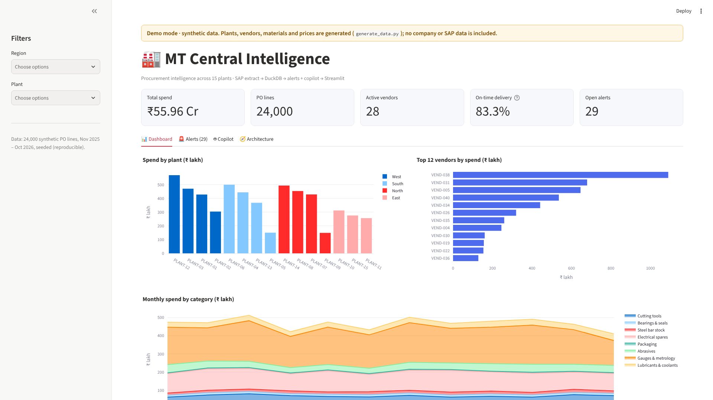
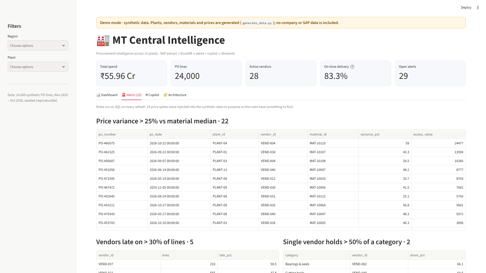
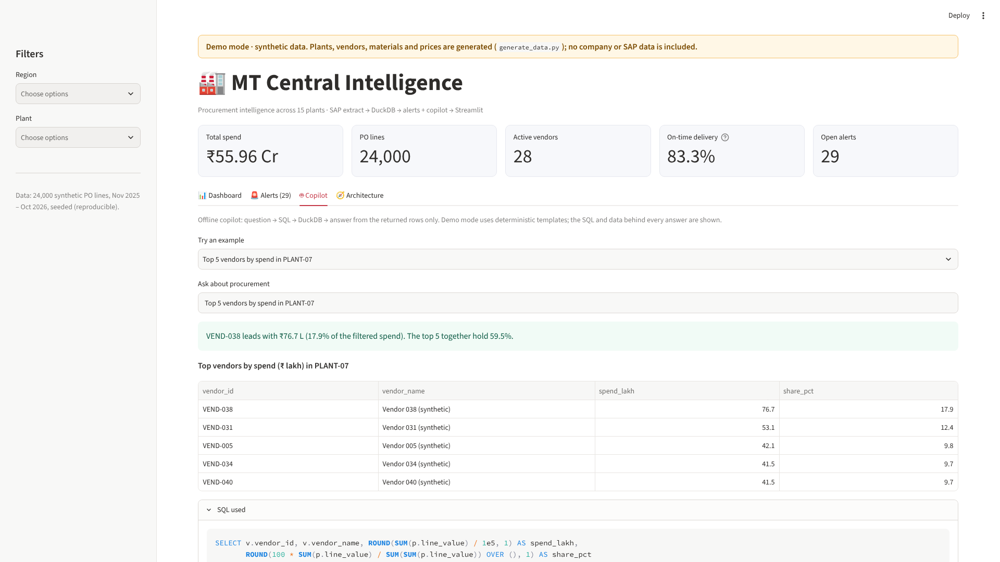

# MT Central Intelligence · demo mode

> **Problem:** procurement data for 15 plants sits in SAP, and plant heads only see overspend, late vendors and supplier concentration after the fact.
> **Solution:** load SAP purchase-order extracts into DuckDB, run alert rules as SQL, and let users ask questions through a copilot that always shows the SQL and rows behind its answer.
>
> **Key features:** ① KPI cards plus spend by plant, vendor and category · ② SQL alert engine (price variance vs material median, late vendors, single-vendor concentration) · ③ Copilot: question → SQL → DuckDB → answer, with the SQL and data shown
>
> **Tech stack:** Python · DuckDB · Streamlit · Plotly · pandas
>
> **Status:** this repository is a **demo-mode build on synthetic data**. The production version runs inside Micro Turners on real SAP data, which is not included here.
>
> **How this maps to battery-lifespan prediction:** it's the data-pipeline half of his project. Raw records (here POs; there MD outputs or cycling logs) go into a fast analytical store, rules and models run over it, and a dashboard plus copilot explain every number back to the source rows.

## Architecture



## Run demo mode

```bash
python -m venv .venv && source .venv/bin/activate
pip install -r requirements.txt
python generate_data.py        # builds data/procurement_synthetic.duckdb (seeded, about 3 s)
streamlit run app.py           # dashboard loads in about 3 s
```

The page shows **"Demo mode · synthetic data"** at the top.

## About the synthetic data

- 15 plants (`PLANT-01…15`), 40 vendors (`VEND-001…040`), 123 materials (`MAT-10001…`) across 8 categories, and 24,000 PO lines from Nov 2025 to Oct 2026.
- Lognormal prices with mild drift, skewed vendor shares per category, and late deliveries driven by a per-vendor reliability score.
- **18 price spikes are injected on purpose** so the alert rules have something to find.
- No real company, vendor, material or price data is used.

## Copilot in demo mode

Demo mode uses deterministic question templates (`copilot.py`), so answers are reproducible offline and every answer shows its SQL and result rows. In the production design an LLM takes the place of `copilot.match()` under the same contract: produce SQL, run it on DuckDB, and answer only from the returned rows.




